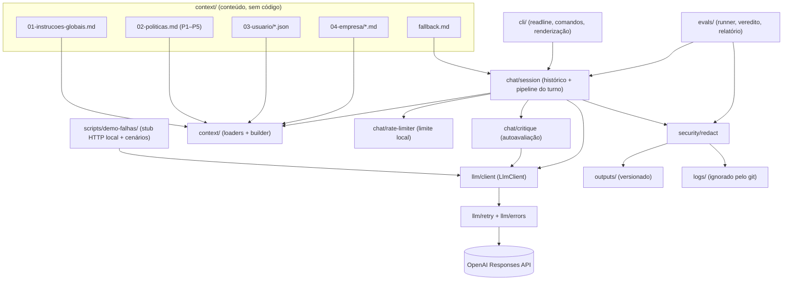
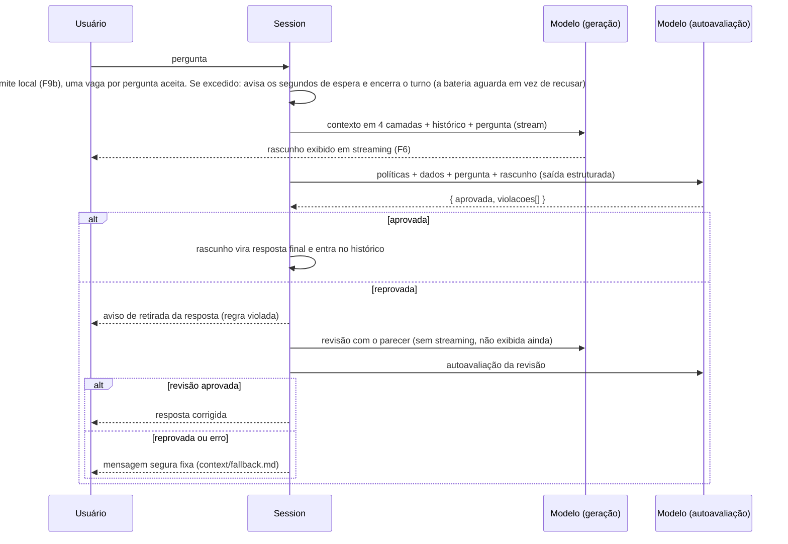

# Arquitetura — Assistente de Onboarding (Chatbot CLI)

> Status: PROPOSTA (16/11/2026), aguardando aprovação do dono.
> Requisitos em `docs/PRD.md`. Decisões detalhadas em `docs/adr/`. Trabalho quebrado em `docs/BACKLOG.md`.

## 1. Visão geral

Aplicação de terminal, local, de processo único e sem estado persistente. Não há servidor, banco de dados, fila nem hospedagem: o PRD descreve uso individual na máquina do usuário, com histórico descartado ao sair.

O projeto tem três executáveis, todos sobre o mesmo núcleo:

| Executável | Comando | Para quê |
|---|---|---|
| Chat | `npm run chat` | Sessão interativa (F4–F10) |
| Bateria de avaliação | `npm run eval` | 12 casos x 3 execuções contra o modelo real (F11–F13) |
| Demonstração de falhas | `npm run demo:falhas` | Evidência reproduzível de retry e rate limit do provedor (F8, F9a) |

## 2. Stack

| Item | Escolha | Por que esta | Alternativa descartada (motivo) |
|---|---|---|---|
| Linguagem | TypeScript, modo `strict`, módulos ESM | Fixo pelo enunciado (T2); `strict` pega erros de contrato entre módulos | JavaScript puro (contraria o enunciado) |
| Runtime | Node.js 22 ou superior (recomendado: LTS atual, 24) | O SDK `openai` atual (7.x) exige Node >= 22; traz `readline/promises`, `parseArgs`, `fetch` e `process.loadEnvFile` nativos | Bun/Deno (o avaliador teria de instalar um runtime incomum) |
| Execução do TS | `tsx` (sem etapa de build) | Um comando roda o projeto; nada de `dist/` para manter | `tsc` + `node dist` (etapa extra sem ganho para CLI local); type-stripping nativo do Node (restrições de sintaxe e de extensão de import que só atrapalham) |
| Gerenciador de pacotes | npm (com `package-lock.json` versionado) | Já vem com o Node; o avaliador só precisa de `npm install` | pnpm/yarn (instalação extra para o avaliador) |
| Provedor de LLM | SDK oficial `openai`, Responses API | Fixo pelo enunciado (T3); a Responses API é a interface principal da documentação atual e suporta streaming e saída estruturada | Chat Completions (ainda funciona, mas é a interface legada e tem restrições com modelos de raciocínio); chamadas HTTP manuais (reimplementar SSE e erros tipados) |
| Modelo | `gpt-6-luna` (configurável por `OPENAI_MODEL`) | Modelo corrente mais barato sem data de desligamento (US$ 0,10 / 0,50 por 1M tokens), com streaming e structured outputs. Ver ADR 0002 | `gpt-5-nano` (mais barato, mas desliga em 11/12/2026); `gpt-4o-mini` (desliga em 14/01/2027); `gpt-5.6-luna` (2x o preço); `gpt-6.1-terra` (10x o preço) |
| Interface de terminal | `node:readline/promises` + `node:util.parseArgs` | Zero dependência para um laço de perguntas e 5 opções de linha de comando | `inquirer`/`commander`/`ink` (dependências para algo que a biblioteca padrão resolve) |
| Variáveis de ambiente | `process.loadEnvFile()` nativo + validação com `zod` | Sem dependência; falha cedo com mensagem clara | `dotenv` (dependência desnecessária em Node >= 22) |
| Validação de dados | `zod` | Valida `.env`, perfis, casos de teste e a saída estruturada da autoavaliação (integra com `openai/helpers/zod`) | Validação manual (frágil); JSON Schema + ajv (mais verboso) |
| Testes unitários | Vitest | Roda TS sem configuração e tem fake timers maduros (essenciais para testar backoff e janela de rate limit) | `node:test` (mock de timers menos ergonômico); Jest (configuração ESM/TS trabalhosa) |
| Lint e formatação | ESLint + typescript-eslint, Prettier | Padrão maduro e conhecido | Biome (mais simples, porém menos difundido) |
| Banco de dados | Nenhum | Histórico só em memória (F7); contexto e casos são arquivos versionados | SQLite (persistência está fora do MVP) |
| Hospedagem | Nenhuma (execução local) | PRD: uso individual e local | Qualquer deploy (fora do MVP) |
| Autenticação | Nenhuma de usuário; credencial da OpenAI por `OPENAI_API_KEY` | PRD exclui autenticação; a chave nunca entra no repositório (ADR 0007) | Chave em arquivo de configuração versionado (vazamento) |
| CI | GitHub Actions mínimo (`.github/workflows/ci.yml`): `npm ci` + `npm run check` a cada PR e push na `main`, sem a chave da OpenAI | Aprovado pelo dono, embora o PRD deixasse CI fora do MVP; confere o mesmo portão local a cada PR, sem secret e sem chamada à API real. Ver ADR 0001 | Nenhum CI (proposta original); rodar a bateria F12 no CI (exigiria a chave como secret e gastaria crédito) |

Dependências de runtime: `openai`, `zod`. De desenvolvimento: `typescript`, `tsx`, `vitest`, `eslint`, `typescript-eslint`, `prettier`, `@types/node`. Qualquer outra exige justificativa.

## 3. Componentes



Regras de dependência entre módulos:

- `cli/` e `evals/` são as únicas bordas; ambos usam `chat/session` e nunca chamam a OpenAI diretamente.
- Toda chamada ao provedor passa por `llm/client`, que sempre passa por `llm/retry`. Não existe outro ponto de saída de rede.
- Toda escrita em disco (`outputs/`, `logs/`) passa por `security/redact`. Única exceção de caminho: `docs/CASOS-DE-TESTE.md`, documento gerado por `npm run casos:doc`, que o escritor só aceita porque `evals/cases-doc-cli.ts` o declara em `extraFiles` (comparação exata do texto do caminho, sem normalização; `..`, caminho absoluto, outra caixa, barra invertida ou ponto final são recusados). Na criação do escritor, cada item precisa começar com o prefixo exato `docs/` (`src/`, `.git/`, `.github/` e a raiz são recusados) e não pode conter `:` (letra de unidade, fluxo alternativo de dados); o arquivo extra só aceita sobrescrita por `writeText` (`appendText`, `appendJsonLine` e `writeJson` são recusados). Symlink ou junction em `docs/` não é verificado (o mesmo limite de `outputs/`). A redação continua valendo. `extraFiles` só aparece em `security/safe-writer.ts` e em `evals/cases-doc-cli.ts` (guarda de arquitetura).
- `src/` não contém nenhum texto de domínio (nome da empresa, regras, contatos). Domínio vive só em `context/` e `evals/casos.json`.

## 4. Pipeline de um turno



Demonstração de falhas (ENG-54): `scripts/demo-falhas/run.ts` cria o mesmo `LlmClient` do chat (o `withRetry` está dentro dele) com `baseURL` apontando para um servidor `node:http` local em `127.0.0.1` e um `fetch` com guarda que só aceita esse endereço. Só a espera é trocada por uma que mede a duração real, sobre o `defaultSleep` do chat; o jitter é desligado para a transcrição ser determinística. Não há mudança em `src/`. A transcrição vai a `outputs/evidencias/retry-rate-limit.txt` pelo escritor único, só se todos os cenários conferem. Decisões 23 a 29 do ADR 0005.

Bateria (ENG-56): `scripts/eval.ts` liga o cliente real, os relógios e o terminal a `evals/cli.ts`, que valida tudo antes da primeira chamada (argumentos, casos, contexto de todos os perfis, configuração) e entrega a `evals/runner.ts`. O runner cria uma `createChatSession` nova por execução, com o mesmo pipeline do chat (rascunho, autoavaliação, revisão, retry) e um coletor no lugar do terminal, envia os turnos do caso em ordem, aplica as checagens de `evals/verdict.ts` ao texto final do último turno e grava uma linha em `outputs/<AAAA-MM-DDTHH-mm-ssZ>/execucoes.jsonl` pelo escritor único assim que a execução termina. Um limitador único por bateria, em modo de espera, respeita o limite local. Erro de infraestrutura é `erro`, mensagem segura como resposta final é `falhou`; o terminal mostra o progresso. Código de saída 0 só se tudo passou. Detalhes e desvios do formato: nota de implementação do ADR 0006.

Juiz, relatório e catálogo (ENG-57): depois do veredito determinístico, `evals/judge.ts` faz uma chamada com saída estruturada pelo mesmo `LlmClient` (modelo de `EVAL_JUDGE_MODEL`), com uma vaga do mesmo limitador. No fim da bateria, o runner agrega as linhas (`evals/aggregate.ts`), valida o resultado com `summarySchema` e grava `resumo.json` e `RELATORIO.md` uma vez cada, pelo escritor único; se o relatório não puder ser montado, o resultado da bateria é mantido, `execucoes.jsonl` fica completo e o código de saída é 2 quando tudo passou (nunca verde sem relatório). `npm run casos:doc` (`scripts/casos-doc.ts` → `evals/cases-doc-cli.ts`) gera `docs/CASOS-DE-TESTE.md` a partir de `evals/casos.json`, sem chave e sem rede; um teste compara o arquivo versionado com a saída do renderizador.

Retry (ENG-51): cada chamada do `LlmClient` passa por `withRetry` (em `runCall`, dentro de `src/llm/client.ts`). Antes de cada nova tentativa, o cliente chama o `onRetry` da própria requisição, e a sessão mostra uma linha com o motivo, a tentativa e a espera; só depois a espera começa (abortável). Se já havia texto parcial na tela, a sessão fecha a linha, avisa que o texto acima será descartado e deixa a nova geração começar logo abaixo; o parcial nunca entra no histórico. `REQUEST_TIMEOUT_MS` vale por tentativa. Detalhes: `docs/adr/0005-retry-rate-limit-e-evidencias.md`.

Autoavaliação (ENG-53): `src/chat/session.ts` executa as quatro fases (rascunho em streaming, avaliação, revisão sem exibição, avaliação da revisão) e cai na mensagem segura em qualquer falha (fail-closed). `src/chat/critique.ts` é puro: o schema estrito da avaliação, a normalização do parecer e a montagem das requisições do avaliador (camadas 2, 3 e 4, as 6 últimas mensagens do histórico, pergunta e rascunho delimitados) e da revisão (contexto completo). Os prompts do avaliador e da revisão ficam em `context/avaliador.md` e `context/revisao.md`, fora das quatro camadas. `src/security/stream-redact.ts` redige o rascunho enquanto ele chega, e `src/logging/session-log.ts` grava uma linha por turno em `logs/`, pelo escritor único. O terminal mostra o aviso de retirada em stdout e, no modo detalhado (`--verbose` ou `/detalhes`), o parecer em stderr. Decisões e divergências: `docs/adr/0004-streaming-e-self-critique.md` (nota de implementação).

Invariante do sistema: **só entra no histórico e só é rotulado como resposta final um texto aprovado pela autoavaliação ou a mensagem segura fixa.** Detalhes e alternativas em `docs/adr/0004-streaming-e-self-critique.md`.

## 5. Como os quatro pontos em aberto do PRD foram resolvidos

| Ponto | Decisão resumida | ADR |
|---|---|---|
| Streaming x self-critique | Streaming real do rascunho; autoavaliação logo após; se reprovado, retratação visível + uma revisão avaliada antes de ser exibida + mensagem segura fixa como último recurso. Falha na autoavaliação conta como reprovação (fail-closed) | 0004 |
| Evidência de retry e rate limit do provedor | Retry próprio (o do SDK é desligado), com classificação de erros; evidência em três níveis: testes unitários com relógio falso, script `demo:falhas` com servidor HTTP local devolvendo 429/500/401 ao SDK real, e roteiro manual do PRD no README | 0005 |
| Quatro camadas separadas e reutilizáveis | Uma fonte física por camada em `context/`, um loader por camada, um builder puro que as delimita; `--context-dir` troca o domínio inteiro sem tocar em `src/` | 0003 |
| Runner dos testes e formato dos outputs | Casos em `evals/casos.json`; runner usa o mesmo pipeline do chat; veredito = checagens determinísticas + juiz com rubrica; saída em `outputs/<execução>/` com `execucoes.jsonl`, `resumo.json` e `RELATORIO.md` | 0006 |

## 6. Estrutura de pastas

```
.
├── CLAUDE.md                     # guia para os agentes
├── README.md                     # instruções de execução (F15) — issue 18
├── .env.example                  # nomes das variáveis, sem valores reais
├── .gitignore                    # .env, node_modules/, logs/, PDF do enunciado
├── .gitattributes                # finais de linha em LF
├── .editorconfig                 # UTF-8, LF, 2 espaços
├── .nvmrc                        # versão do Node (usada também pelo CI)
├── .github/workflows/ci.yml      # CI: npm ci + npm run check, sem a chave
├── CHANGELOG.md                  # histórico de mudanças (Keep a Changelog)
├── package.json / package-lock.json
├── tsconfig.json / eslint.config.js / .prettierrc / vitest.config.ts
│
├── context/                      # AS QUATRO CAMADAS (somente conteúdo)
│   ├── 01-instrucoes-globais.md  # camada 1: papel, tom, formato
│   ├── 02-politicas.md           # camada 2: P1–P5 (é o documento de políticas, F1)
│   ├── 03-usuario/               # camada 3: um JSON por perfil
│   │   ├── ana-souza.json
│   │   └── bruno-lima.json
│   ├── 04-empresa/               # camada 4: base de conhecimento
│   │   ├── normas-internas.md    # jornada, trabalho remoto, férias
│   │   ├── beneficios.md
│   │   ├── processos.md          # reembolso, acesso, ponto
│   │   ├── ferramentas.md
│   │   └── contatos.md           # quem procurar + canais de P4
│   ├── avaliador.md              # prompt do avaliador (não é camada; texto genérico)
│   ├── juiz.md                   # prompt do juiz da bateria (não é camada; texto genérico, entra no hashContexto)
│   ├── revisao.md                # prompt da revisão (não é camada; marcador {{violacoes}})
│   └── fallback.md               # mensagem segura fixa (não é camada; nunca vai ao modelo)
│
├── src/
│   ├── cli/
│   │   ├── main.ts               # entrada do chat: argumentos, laço readline
│   │   ├── chat-loop.ts          # laço readline: lê linhas, executa comandos, encerra com Ctrl+C
│   │   ├── commands.ts           # /sair /limpar /contexto /detalhes /ajuda
│   │   └── renderer.ts           # escrita no terminal (stream, avisos, modo detalhado)
│   ├── config/
│   │   └── env.ts                # leitura e validação das variáveis de ambiente
│   ├── context/
│   │   ├── types.ts              # ContextLayers, UserProfile
│   │   ├── loaders.ts            # um loader por camada
│   │   └── builder.ts            # buildContext(): função pura, camadas delimitadas
│   ├── llm/
│   │   ├── client.ts             # interface LlmClient + implementação OpenAI
│   │   ├── smoke.ts              # lógica do teste de fumaça usada por smoke-llm.ts
│   │   ├── errors.ts             # classifyError(): transitório / rate limit / fatal; textos de falha e de aviso
│   │   └── retry.ts              # withRetry(): backoff exponencial, jitter, retry-after, onRetry, espera abortável
│   ├── chat/
│   │   ├── session.ts            # histórico em memória + pipeline do turno (aplica o limite local)
│   │   ├── critique.ts           # autoavaliação: schema, parecer normalizado, requisições do avaliador e da revisão (puro)
│   │   └── rate-limiter.ts       # janela deslizante local: relógio e espera injetados; recusa ou aguarda; sem I/O
│   ├── security/
│   │   ├── redact.ts             # remove credenciais de qualquer texto gravado
│   │   ├── stream-redact.ts      # redige o rascunho enquanto chega (retém a cauda que ainda pode virar segredo)
│   │   ├── safe-writer.ts        # escritor único de outputs/ e logs/ (aplica redact); exceção: `extraFiles`
│   │   ├── error-summary.ts      # resume um erro: status, código, tipo, mensagem
│   │   └── secret-scan.ts        # lógica da varredura usada por check-secrets.ts
│   └── logging/
│       └── session-log.ts        # registro da sessão em logs/ (redigido)
│
├── evals/
│   ├── casos.json                # os 12 casos (F11), fonte única
│   ├── schema.ts                 # esquema zod dos casos e parseCases (ENG-55)
│   ├── normalize.ts              # normalizeForMatch: comparação sem maiúsculas e acentos
│   ├── args.ts                   # --runs e --case (ENG-56)
│   ├── cli.ts                    # runEvalCli: ordem de validação, limitador, escritor (tudo injetado)
│   ├── contexts.ts               # um contexto por perfil, carregado antes da chave
│   ├── runner.ts                 # runBattery: sessão nova por execução, uma linha jsonl por execução; no fim, resumo.json e RELATORIO.md
│   ├── collector.ts              # ChatOutput que não escreve no terminal
│   ├── retry-count.ts            # decorador do LlmClient que conta novas tentativas por turno
│   ├── record.ts                 # esquema zod (v1) da linha de execucoes.jsonl
│   ├── battery-id.ts             # nome da pasta de cada bateria
│   ├── verdict.ts                # checagens determinísticas + veredito final (checagens e juiz)
│   ├── judge.ts                  # juiz por rubrica: mesma via do LlmClient, saída estruturada
│   ├── context-hash.ts           # sha256 de context/ e de casos.json (hashContexto, hashCasos)
│   ├── aggregate.ts              # agregador puro e summarySchema (resumo.json)
│   ├── report.ts                 # RELATORIO.md (puro, determinístico)
│   ├── markdown.ts               # sanitizadores de texto não confiável para Markdown
│   ├── redact-lines.ts           # redige as linhas antes de agregar e renderizar
│   ├── cases-doc.ts              # renderCasesDoc: docs/CASOS-DE-TESTE.md (puro, sem data)
│   └── cases-doc-cli.ts          # runCasesDocCli: lê casos.json e grava o documento (tudo injetado)
│
├── scripts/
│   ├── eval.ts                   # entrada de `npm run eval`: só liga as peças reais a evals/cli.ts
│   ├── casos-doc.ts              # entrada de `npm run casos:doc`: só liga as peças a evals/cases-doc-cli.ts
│   ├── demo-falhas.ts            # entrada de `npm run demo:falhas`: só liga as peças
│   ├── demo-falhas/              # a demonstração de falhas (ENG-54)
│   │   ├── config.ts             # chave falsa, tempos e configuração do cliente (parseConfig, sem ambiente)
│   │   ├── stub-server.ts        # servidor node:http em 127.0.0.1, roteiro por caminho
│   │   ├── loopback-fetch.ts     # fetch que só aceita http://127.0.0.1 e conta as chamadas
│   │   ├── scenarios.ts          # os 5 cenários e o esperado de cada um
│   │   ├── observe.ts            # roda um cenário com o cliente real e registra o resultado
│   │   ├── report.ts             # comparação esperado x obtido e texto da transcrição
│   │   └── run.ts                # runDemo: único arquivo que cria o cliente real da demo
│   ├── show-context.ts           # imprime o contexto montado
│   ├── smoke-llm.ts              # teste de fumaça manual contra a API real (gasta crédito)
│   └── check-secrets.ts          # varredura de credenciais nos arquivos do repositório
│
├── tests/                        # testes unitários (Vitest), sem rede
│
├── outputs/                      # VERSIONADO: entregável E4
│   ├── <AAAA-MM-DDTHH-mm-ssZ>/   # uma pasta por execução da bateria
│   │   ├── execucoes.jsonl       # uma linha por execução, gravada ao terminar (evidência bruta)
│   │   ├── resumo.json           # agregados legíveis por máquina (esquema 1), gravado uma vez no fim
│   │   └── RELATORIO.md          # relatório de consistência e transcrição, gravado uma vez no fim
│   └── evidencias/
│       └── retry-rate-limit.txt  # transcrição de `npm run demo:falhas`
│
├── logs/                         # IGNORADO pelo git
│
└── docs/
    ├── PRD.md
    ├── ARQUITETURA.md
    ├── BACKLOG.md
    ├── CASOS-DE-TESTE.md         # gerado a partir de evals/casos.json
    ├── REUSO.md                  # como reaproveitar a estrutura em outro domínio
    ├── ANALISE.md                # análise de comportamento (F14)
    └── adr/
```

## 7. Configuração

Variáveis de ambiente (todas documentadas em `.env.example`; só `OPENAI_API_KEY` é obrigatória):

| Variável | Padrão | Efeito |
|---|---|---|
| `OPENAI_API_KEY` | — | Credencial. Ausente: o programa encerra com orientação de correção |
| `OPENAI_MODEL` | `gpt-6-luna` | Modelo de geração e de autoavaliação |
| `OPENAI_REASONING_EFFORT` | `low` | Esforço de raciocínio do modelo (ver ADR 0002) |
| `EVAL_JUDGE_MODEL` | igual a `OPENAI_MODEL` | Modelo do juiz da bateria |
| `REQUEST_TIMEOUT_MS` | `60000` | Tempo limite por chamada |
| `RETRY_MAX_ATTEMPTS` | `3` | Novas tentativas após a primeira falha |
| `RETRY_BASE_DELAY_MS` | `1000` | Base do backoff exponencial |
| `RATE_LIMIT_MAX_REQUESTS` | `20` | Perguntas permitidas por janela (limite local; inteiro >= 1, sem teto superior) |
| `RATE_LIMIT_WINDOW_SECONDS` | `60` | Tamanho da janela do limite local (inteiro >= 1, sem teto superior) |

Opções de linha de comando do chat (`src/cli/args.ts`, o único arquivo que usa `parseArgs`; `src/cli/main.ts` é o único que lê `process.argv`): `--system-prompt <arquivo>` (substitui só a camada 1; `.md` ou `.txt`), `--perfil <nome|arquivo>` (escolhe a camada 3: nome de `03-usuario/` ou caminho de um `.json`), `--context-dir <pasta>` (troca o domínio), `--verbose` (detalhes técnicos e resultado da autoavaliação em stderr, a cada resposta; o mesmo que começar com `/detalhes` ligado), `--show-context` (imprime o contexto montado e sai antes de ler a configuração: sem chave, sem `.env`, sem rede) e `-h`/`--help`. A chave da API não é opção, e um teste confere que o parser não declara nenhuma. Opção repetida e argumento posicional são erro de uso. Códigos de saída: 0 normal, ajuda e `--show-context`; 1 uso inválido, configuração ou contexto; 2 erro inesperado. Todo arquivo de camada tem no máximo 64 KiB e precisa ser um arquivo comum.

Comandos dentro do chat: `/sair`, `/limpar`, `/contexto`, `/detalhes`, `/ajuda`.

## 8. Custo estimado

Contexto fixo estimado em 4 a 6 mil tokens. Cada execução da bateria faz geração + autoavaliação + juiz: cerca de 12 mil tokens de entrada e 1,5 mil de saída, perto de US$ 0,002. A bateria completa (36 execuções) fica em torno de US$ 0,10; com dez iterações de ajuste, abaixo de US$ 1,50. O cache de prompt do provedor reduz ainda mais, porque o contexto é idêntico entre chamadas.

## 9. Limitações assumidas

- Sem controle de tamanho do contexto: histórico e base entram inteiros (fora do MVP; a janela do modelo é de cerca de 1M tokens).
- A resposta reprovada chega a aparecer na tela antes da retratação (consequência aceita do streaming real; ver ADR 0004).
- `gpt-6-luna` não tem snapshot datado: o comportamento pode mudar com atualizações do provedor. Os outputs gravam o identificador de modelo devolvido pela API.
- O juiz da bateria é um modelo; a análise (F14) inclui revisão manual dos outputs.

### Limites conhecidos do chat interativo (ENG-49)

- O renderer neutraliza caracteres de controle (ESC, C0, DEL, C1) só na exibição; o histórico e o que vai ao modelo não mudam. Um erro de escrita em stdout/stderr encerra o chat sem stack (EPIPE: código 0; outro erro: uma linha e código 1).
- O texto do modelo passa por redação de chave antes de aparecer na tela e de entrar no histórico (ENG-53: `stream-redact.ts` e `redact.ts`). A chave só chega ao modelo se estiver no contexto, o que as regras proíbem. Uma chave com menos de 20 caracteres depois do prefixo, cortada no fim do texto, não é reconhecida como chave.
- O histórico não tem limite: o custo e o tamanho da entrada crescem a cada turno (use `/limpar`).
- Ctrl+C em um terminal real (TTY) não foi verificado à mão; os testes cobrem o sinal e o cancelamento do turno, não o terminal.
- O primeiro Ctrl+C cancela o turno (inclusive durante a espera de uma nova tentativa) e encerra o chat; o segundo encerra o programa na hora (`process.exit` com o código de saída de um erro de escrita, ou 0). Mantém-se o código 0.
- Não há limite de tempo total para uma pergunta: o prazo vale por tentativa, e o pior caso é `(RETRY_MAX_ATTEMPTS + 1) x REQUEST_TIMEOUT_MS` mais esperas de até 30 s cada. Um `Retry-After` maior que 30 s faz a chamada falhar na hora, com a orientação de tentar mais tarde.
- `OPENAI_CUSTOM_HEADERS` é recusada na configuração (ver ADR 0002, decisão 9).
