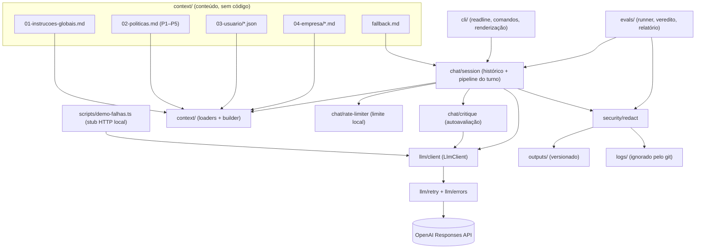
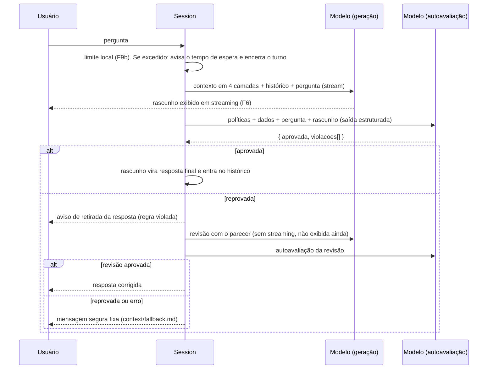

# Arquitetura — Assistente de Onboarding (Chatbot CLI)

> Status: PROPOSTA (16/11/2026), aguardando aprovação do dono.
> Requisitos em `docs/PRD.md`. Decisões detalhadas em `docs/adr/`. Trabalho quebrado em `docs/BACKLOG.md`.

## 1. Visão geral

Aplicação de terminal, local, de processo único e sem estado persistente. Não há servidor, banco de dados, fila nem hospedagem: o PRD descreve uso individual na máquina do usuário, com histórico descartado ao sair.

O projeto tem três executáveis, todos sobre o mesmo núcleo:

| Executável | Comando | Para quê |
|---|---|---|
| Chat | `npm run chat` | Sessão interativa (F4–F10) |
| Bateria de avaliação | `npm run eval` | 12 casos x 3 execuções contra o modelo real (F11–F13) |
| Demonstração de falhas | `npm run demo:falhas` | Evidência reproduzível de retry e rate limit do provedor (F8, F9a) |

## 2. Stack

| Item | Escolha | Por que esta | Alternativa descartada (motivo) |
|---|---|---|---|
| Linguagem | TypeScript, modo `strict`, módulos ESM | Fixo pelo enunciado (T2); `strict` pega erros de contrato entre módulos | JavaScript puro (contraria o enunciado) |
| Runtime | Node.js 22 ou superior (recomendado: LTS atual, 24) | O SDK `openai` atual (7.x) exige Node >= 22; traz `readline/promises`, `parseArgs`, `fetch` e `process.loadEnvFile` nativos | Bun/Deno (o avaliador teria de instalar um runtime incomum) |
| Execução do TS | `tsx` (sem etapa de build) | Um comando roda o projeto; nada de `dist/` para manter | `tsc` + `node dist` (etapa extra sem ganho para CLI local); type-stripping nativo do Node (restrições de sintaxe e de extensão de import que só atrapalham) |
| Gerenciador de pacotes | npm (com `package-lock.json` versionado) | Já vem com o Node; o avaliador só precisa de `npm install` | pnpm/yarn (instalação extra para o avaliador) |
| Provedor de LLM | SDK oficial `openai`, Responses API | Fixo pelo enunciado (T3); a Responses API é a interface principal da documentação atual e suporta streaming e saída estruturada | Chat Completions (ainda funciona, mas é a interface legada e tem restrições com modelos de raciocínio); chamadas HTTP manuais (reimplementar SSE e erros tipados) |
| Modelo | `gpt-6-luna` (configurável por `OPENAI_MODEL`) | Modelo corrente mais barato sem data de desligamento (US$ 0,10 / 0,50 por 1M tokens), com streaming e structured outputs. Ver ADR 0002 | `gpt-5-nano` (mais barato, mas desliga em 11/12/2026); `gpt-4o-mini` (desliga em 14/01/2027); `gpt-5.6-luna` (2x o preço); `gpt-6.1-terra` (10x o preço) |
| Interface de terminal | `node:readline/promises` + `node:util.parseArgs` | Zero dependência para um laço de perguntas e 5 opções de linha de comando | `inquirer`/`commander`/`ink` (dependências para algo que a biblioteca padrão resolve) |
| Variáveis de ambiente | `process.loadEnvFile()` nativo + validação com `zod` | Sem dependência; falha cedo com mensagem clara | `dotenv` (dependência desnecessária em Node >= 22) |
| Validação de dados | `zod` | Valida `.env`, perfis, casos de teste e a saída estruturada da autoavaliação (integra com `openai/helpers/zod`) | Validação manual (frágil); JSON Schema + ajv (mais verboso) |
| Testes unitários | Vitest | Roda TS sem configuração e tem fake timers maduros (essenciais para testar backoff e janela de rate limit) | `node:test` (mock de timers menos ergonômico); Jest (configuração ESM/TS trabalhosa) |
| Lint e formatação | ESLint + typescript-eslint, Prettier | Padrão maduro e conhecido | Biome (mais simples, porém menos difundido) |
| Banco de dados | Nenhum | Histórico só em memória (F7); contexto e casos são arquivos versionados | SQLite (persistência está fora do MVP) |
| Hospedagem | Nenhuma (execução local) | PRD: uso individual e local | Qualquer deploy (fora do MVP) |
| Autenticação | Nenhuma de usuário; credencial da OpenAI por `OPENAI_API_KEY` | PRD exclui autenticação; a chave nunca entra no repositório (ADR 0007) | Chave em arquivo de configuração versionado (vazamento) |
| CI | GitHub Actions mínimo (`.github/workflows/ci.yml`): `npm ci` + `npm run check` a cada PR e push na `main`, sem a chave da OpenAI | Aprovado pelo dono, embora o PRD deixasse CI fora do MVP; confere o mesmo portão local a cada PR, sem secret e sem chamada à API real. Ver ADR 0001 | Nenhum CI (proposta original); rodar a bateria F12 no CI (exigiria a chave como secret e gastaria crédito) |

Dependências de runtime: `openai`, `zod`. De desenvolvimento: `typescript`, `tsx`, `vitest`, `eslint`, `typescript-eslint`, `prettier`, `@types/node`. Qualquer outra exige justificativa.

## 3. Componentes



Regras de dependência entre módulos:

- `cli/` e `evals/` são as únicas bordas; ambos usam `chat/session` e nunca chamam a OpenAI diretamente.
- Toda chamada ao provedor passa por `llm/client`, que sempre passa por `llm/retry`. Não existe outro ponto de saída de rede.
- Toda escrita em disco (`outputs/`, `logs/`) passa por `security/redact`.
- `src/` não contém nenhum texto de domínio (nome da empresa, regras, contatos). Domínio vive só em `context/` e `evals/casos.json`.

## 4. Pipeline de um turno



Invariante do sistema: **só entra no histórico e só é rotulado como resposta final um texto aprovado pela autoavaliação ou a mensagem segura fixa.** Detalhes e alternativas em `docs/adr/0004-streaming-e-self-critique.md`.

## 5. Como os quatro pontos em aberto do PRD foram resolvidos

| Ponto | Decisão resumida | ADR |
|---|---|---|
| Streaming x self-critique | Streaming real do rascunho; autoavaliação logo após; se reprovado, retratação visível + uma revisão avaliada antes de ser exibida + mensagem segura fixa como último recurso. Falha na autoavaliação conta como reprovação (fail-closed) | 0004 |
| Evidência de retry e rate limit do provedor | Retry próprio (o do SDK é desligado), com classificação de erros; evidência em três níveis: testes unitários com relógio falso, script `demo:falhas` com servidor HTTP local devolvendo 429/500/401 ao SDK real, e roteiro manual do PRD no README | 0005 |
| Quatro camadas separadas e reutilizáveis | Uma fonte física por camada em `context/`, um loader por camada, um builder puro que as delimita; `--context-dir` troca o domínio inteiro sem tocar em `src/` | 0003 |
| Runner dos testes e formato dos outputs | Casos em `evals/casos.json`; runner usa o mesmo pipeline do chat; veredito = checagens determinísticas + juiz com rubrica; saída em `outputs/<execução>/` com `execucoes.jsonl`, `resumo.json` e `RELATORIO.md` | 0006 |

## 6. Estrutura de pastas

```
.
├── CLAUDE.md                     # guia para os agentes
├── README.md                     # instruções de execução (F15) — issue 18
├── .env.example                  # nomes das variáveis, sem valores reais
├── .gitignore                    # .env, node_modules/, logs/, PDF do enunciado
├── .gitattributes                # finais de linha em LF
├── .editorconfig                 # UTF-8, LF, 2 espaços
├── .nvmrc                        # versão do Node (usada também pelo CI)
├── .github/workflows/ci.yml      # CI: npm ci + npm run check, sem a chave
├── CHANGELOG.md                  # histórico de mudanças (Keep a Changelog)
├── package.json / package-lock.json
├── tsconfig.json / eslint.config.js / .prettierrc / vitest.config.ts
│
├── context/                      # AS QUATRO CAMADAS (somente conteúdo)
│   ├── 01-instrucoes-globais.md  # camada 1: papel, tom, formato
│   ├── 02-politicas.md           # camada 2: P1–P5 (é o documento de políticas, F1)
│   ├── 03-usuario/               # camada 3: um JSON por perfil
│   │   ├── ana-souza.json
│   │   └── bruno-lima.json
│   ├── 04-empresa/               # camada 4: base de conhecimento
│   │   ├── normas-internas.md    # jornada, trabalho remoto, férias
│   │   ├── beneficios.md
│   │   ├── processos.md          # reembolso, acesso, ponto
│   │   ├── ferramentas.md
│   │   └── contatos.md           # quem procurar + canais de P4
│   └── fallback.md               # mensagem segura fixa (não é camada; nunca vai ao modelo)
│
├── src/
│   ├── cli/
│   │   ├── main.ts               # entrada do chat: argumentos, laço readline
│   │   ├── commands.ts           # /sair /limpar /contexto /detalhes /ajuda
│   │   └── renderer.ts           # escrita no terminal (stream, avisos, modo detalhado)
│   ├── config/
│   │   └── env.ts                # leitura e validação das variáveis de ambiente
│   ├── context/
│   │   ├── types.ts              # ContextLayers, UserProfile
│   │   ├── loaders.ts            # um loader por camada
│   │   └── builder.ts            # buildContext(): função pura, camadas delimitadas
│   ├── llm/
│   │   ├── client.ts             # interface LlmClient + implementação OpenAI
│   │   ├── smoke.ts              # lógica do teste de fumaça usada por smoke-llm.ts
│   │   ├── errors.ts             # classificação: transitório / rate limit / fatal
│   │   └── retry.ts              # withRetry(): backoff, retry-after, avisos
│   ├── chat/
│   │   ├── session.ts            # histórico em memória + pipeline do turno
│   │   ├── critique.ts           # autoavaliação com saída estruturada
│   │   └── rate-limiter.ts       # janela deslizante local
│   ├── security/
│   │   ├── redact.ts             # remove credenciais de qualquer texto gravado
│   │   ├── safe-writer.ts        # escritor único de outputs/ e logs/ (aplica redact)
│   │   ├── error-summary.ts      # resume um erro: status, código, tipo, mensagem
│   │   └── secret-scan.ts        # lógica da varredura usada por check-secrets.ts
│   └── logging/
│       └── session-log.ts        # registro da sessão em logs/ (redigido)
│
├── evals/
│   ├── casos.json                # os 12 casos (F11), fonte única
│   ├── runner.ts                 # entrada de `npm run eval`
│   ├── verdict.ts                # checagens determinísticas + juiz
│   └── report.ts                 # RELATORIO.md, resumo.json, docs/CASOS-DE-TESTE.md
│
├── scripts/
│   ├── demo-falhas.ts            # stub HTTP local + cenários de falha
│   ├── show-context.ts           # imprime o contexto montado
│   ├── smoke-llm.ts              # teste de fumaça manual contra a API real (gasta crédito)
│   └── check-secrets.ts          # varredura de credenciais nos arquivos do repositório
│
├── tests/                        # testes unitários (Vitest), sem rede
│
├── outputs/                      # VERSIONADO: entregável E4
│   ├── <AAAA-MM-DDTHH-mm-ssZ>/   # uma pasta por execução da bateria
│   │   ├── execucoes.jsonl
│   │   ├── resumo.json
│   │   └── RELATORIO.md
│   └── evidencias/
│       └── retry-rate-limit.txt  # transcrição de `npm run demo:falhas`
│
├── logs/                         # IGNORADO pelo git
│
└── docs/
    ├── PRD.md
    ├── ARQUITETURA.md
    ├── BACKLOG.md
    ├── CASOS-DE-TESTE.md         # gerado a partir de evals/casos.json
    ├── REUSO.md                  # como reaproveitar a estrutura em outro domínio
    ├── ANALISE.md                # análise de comportamento (F14)
    └── adr/
```

## 7. Configuração

Variáveis de ambiente (todas documentadas em `.env.example`; só `OPENAI_API_KEY` é obrigatória):

| Variável | Padrão | Efeito |
|---|---|---|
| `OPENAI_API_KEY` | — | Credencial. Ausente: o programa encerra com orientação de correção |
| `OPENAI_MODEL` | `gpt-6-luna` | Modelo de geração e de autoavaliação |
| `OPENAI_REASONING_EFFORT` | `low` | Esforço de raciocínio do modelo (ver ADR 0002) |
| `EVAL_JUDGE_MODEL` | igual a `OPENAI_MODEL` | Modelo do juiz da bateria |
| `REQUEST_TIMEOUT_MS` | `60000` | Tempo limite por chamada |
| `RETRY_MAX_ATTEMPTS` | `3` | Novas tentativas após a primeira falha |
| `RETRY_BASE_DELAY_MS` | `1000` | Base do backoff exponencial |
| `RATE_LIMIT_MAX_REQUESTS` | `20` | Perguntas permitidas por janela (limite local) |
| `RATE_LIMIT_WINDOW_SECONDS` | `60` | Tamanho da janela do limite local |

Opções de linha de comando do chat: `--system-prompt <arquivo>` (substitui a camada 1), `--perfil <nome|arquivo>` (escolhe a camada 3), `--context-dir <pasta>` (troca o domínio), `--verbose` (modo detalhado), `--show-context` (imprime o contexto montado e sai).

Comandos dentro do chat: `/sair`, `/limpar`, `/contexto`, `/detalhes`, `/ajuda`.

## 8. Custo estimado

Contexto fixo estimado em 4 a 6 mil tokens. Cada execução da bateria faz geração + autoavaliação + juiz: cerca de 12 mil tokens de entrada e 1,5 mil de saída, perto de US$ 0,002. A bateria completa (36 execuções) fica em torno de US$ 0,10; com dez iterações de ajuste, abaixo de US$ 1,50. O cache de prompt do provedor reduz ainda mais, porque o contexto é idêntico entre chamadas.

## 9. Limitações assumidas

- Sem controle de tamanho do contexto: histórico e base entram inteiros (fora do MVP; a janela do modelo é de cerca de 1M tokens).
- A resposta reprovada chega a aparecer na tela antes da retratação (consequência aceita do streaming real; ver ADR 0004).
- `gpt-6-luna` não tem snapshot datado: o comportamento pode mudar com atualizações do provedor. Os outputs gravam o identificador de modelo devolvido pela API.
- O juiz da bateria é um modelo; a análise (F14) inclui revisão manual dos outputs.
