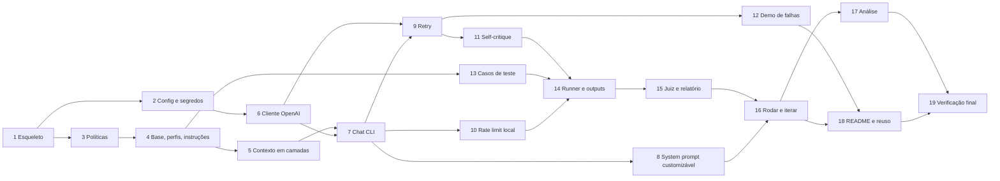

# Backlog do MVP

> Status: APROVADO pelo dono em 16/11/2026. Issues no Linear: ENG-43 a ENG-61, projeto https://linear.app/veracompany/project/chatbot-de-onboarding-cli-53ebabade448
> 19 issues, em ordem de dependência, cada uma estimada em menos de 1 dia.
> Referências: `docs/PRD.md` (F1–F15), `docs/ARQUITETURA.md`, `docs/adr/`.

## Mapa de cobertura F1–F15

| Funcionalidade do PRD | Issues |
|---|---|
| F1 Documento de políticas | 3 |
| F2 Contexto em camadas separadas | 4, 5, 8 (opções de troca), 18 (documento de reuso) |
| F3 Base de conhecimento | 4 |
| F4 Chat interativo em CLI | 7 |
| F5 System prompt customizável | 8 |
| F6 Streaming | 6, 7 |
| F7 Histórico de sessão | 7 |
| F8 Erros com retry | 9, 12 (evidência), 2 (chave ausente) |
| F9 Rate limit | 9 (F9a, provedor), 10 (F9b, local), 12 (evidência de F9a) |
| F10 Self-critique | 11 |
| F11 Casos de teste | 13 |
| F12 Execução e outputs | 14, 16 |
| F13 Consistência (3 execuções) | 15, 16 |
| F14 Análise de comportamento | 17 |
| F15 Instruções de execução, sem credencial no repositório | 1, 2, 18, 19 |

## Ordem e dependências

As issues 3, 4 e 13 são de conteúdo (sem código) e podem andar em paralelo com 2 e 6.

---

## Issue 1 (ENG-43) — Montar o esqueleto do projeto

**Descrição.** Criar o projeto TypeScript vazio, rodando, com lint, verificação de tipos e um teste de exemplo. O portão é o comando `npm run check`, rodado localmente e também pelo CI.

**Já feito no arranque (não recriar nem sobrescrever; ajustar só se necessário):** repositório Git, `.gitignore`, `.gitattributes` (finais de linha em LF), `.editorconfig`, `.nvmrc` (Node 24), `.env.example`, `README.md` inicial, `CHANGELOG.md` e o workflow `.github/workflows/ci.yml`. O workflow roda `npm ci` e `npm run check` e pula as verificações enquanto `package.json` e `package-lock.json` não existirem; ele passa a valer de fato com esta issue.

**Critérios de aceite**
- [x] Node.js >= 22 instalado e disponível no PATH (não estava em 16/11/2026); `package.json` declara `"engines": { "node": ">=22" }` e `"type": "module"`.
- [x] `.gitignore` continua contendo `.env`, `.env.*` (exceto `.env.example`), `node_modules/` e `logs/`; `git check-ignore .env` confirma que `.env` é ignorado.
- [x] `.env.example` continua listando todas as variáveis da seção 7 de `docs/ARQUITETURA.md`, com `OPENAI_API_KEY=` sem valor real.
- [x] `tsconfig.json` com `strict: true`; `npm run typecheck` passa.
- [x] `npm run lint` e `npm run format` funcionam (ESLint + typescript-eslint + Prettier). O Prettier usa `endOfLine: "lf"` (o padrão), coerente com `.gitattributes` e `.editorconfig`.
- [x] `npm test` roda o Vitest uma única vez, sem modo watch (`vitest run`), e um teste de exemplo passa.
- [x] `npm run chat` executa `src/cli/main.ts` via `tsx` e imprime uma mensagem provisória. (Superado pela ENG-49: hoje abre o chat.)
- [x] `npm run check` encadeia lint, typecheck e test, e termina com código 0. Roda sem `OPENAI_API_KEY` e sem rede (é o comando que o CI executa).
- [x] Pastas da seção 6 de `docs/ARQUITETURA.md` criadas; `package-lock.json` versionado (o CI instala com `npm ci`, que exige o lockfile).
- [x] Dependências instaladas: só as listadas na seção 2 de `docs/ARQUITETURA.md`.
- [ ] Depois do push, o workflow de CI executa `npm ci` e `npm run check` (não apenas o aviso de "verificações puladas") e termina verde. (Não conferido na verificação final: o resultado das execuções está no GitHub do arquivo privado, e `npm ci` e `npm run check` passam no clone limpo, ver `docs/VERIFICACAO.md`.)

**Dependências:** nenhuma.

---

## Issue 2 (ENG-44) — Implementar configuração por ambiente e redação de segredos

**Descrição.** Criar o único leitor de variáveis de ambiente, a função de redação de credenciais, o escritor único de arquivos para `outputs/` e `logs/`, e a varredura de segredos. Ver ADR 0007.

**Critérios de aceite**
- [x] `src/config/env.ts` carrega `.env` (se existir) com `process.loadEnvFile`, valida com `zod` e aplica os padrões da seção 7 de `docs/ARQUITETURA.md`. Nenhum outro arquivo de `src/` lê `process.env`.
- [x] Sem `OPENAI_API_KEY`, o programa encerra com código diferente de zero e uma mensagem em português orientando a copiar `.env.example` para `.env` e preencher a chave. Não aparece stack trace.
- [x] Valor inválido em variável numérica (ex.: `RETRY_MAX_ATTEMPTS=abc`) gera mensagem que cita o nome da variável.
- [x] `redact(texto)` substitui por `[REDACTED]` o valor exato da chave em uso e qualquer sequência `sk-` com 20 ou mais caracteres. Teste unitário com chave falsa cobre os dois casos.
- [x] Existe um escritor único para `outputs/` e `logs/` que aplica `redact`; teste unitário grava um texto com chave falsa e confirma que o arquivo não a contém.
- [x] Existe função que resume um erro para registro (status, código, tipo, mensagem), sem cabeçalhos nem corpo da requisição; coberta por teste.
- [x] `npm run check:secrets` varre os arquivos não ignorados pelo Git, falha (código diferente de zero) ao encontrar padrão de chave e passa no repositório limpo. Está incluído em `npm run check`.
- [x] A chave não é aceita por argumento de linha de comando.

**Dependências:** 1.

---

## Issue 3 (ENG-45) — Escrever o documento de políticas P1–P5

**Descrição.** Redigir `context/02-politicas.md`, que é ao mesmo tempo o entregável "documento de políticas" e a camada 2 enviada ao modelo. Conteúdo, sem código. Ver ADR 0003.

**Critérios de aceite**
- [x] O arquivo contém exatamente cinco regras, P1 a P5, com o conteúdo definido em F1 do PRD (tema proibido, linguagem formal, escopo, encaminhamento a humanos, resistência a manipulação).
- [x] Cada regra tem os quatro campos: identificador, descrição, exemplo de pergunta que a aciona e comportamento esperado.
- [x] P4 lista os seis tipos de caso crítico do PRD (assédio ou discriminação, acidente ou risco à saúde/segurança, erro de pagamento/folha, questão legal, incidente de segurança da informação, usuário em sofrimento) e manda usar o contato definido nos dados da empresa, sem escrever o contato no arquivo de regras.
- [x] P3 cobre os dois comportamentos: recusar assunto fora de escopo e dizer "não tenho essa informação" indicando quem procurar quando o dado não está na base.
- [x] O arquivo não contém nenhum dado da empresa (contatos, valores, prazos) nem dado de usuário.
- [x] Legível por uma pessoa sem contexto técnico; sem emojis.

**Dependências:** 1.

---

## Issue 4 (ENG-46) — Escrever instruções globais, perfis e base de conhecimento da empresa fictícia

**Descrição.** Criar o conteúdo das camadas 1, 3 e 4 e a mensagem segura fixa. Tudo inventado (decisão D1 do PRD). Conteúdo, sem código.

**Critérios de aceite**
- [x] `context/01-instrucoes-globais.md` define papel, tom e formato de resposta, sem regras de política e sem fatos da empresa.
- [x] `context/03-usuario/` tem dois perfis em JSON com os campos nome, cargo, área, data de início e gestor; os dois têm gestores diferentes.
- [x] `context/04-empresa/` cobre, em arquivos separados por assunto: normas internas (jornada, trabalho remoto, férias), benefícios, processos (reembolso, solicitação de acesso, ponto), ferramentas e contatos.
- [x] `contatos.md` traz um contato por assunto e um canal humano para cada um dos seis tipos de caso crítico de P4.
- [x] Nenhum arquivo de `04-empresa/` contém regra de comportamento do assistente.
- [x] A base deixa de fora, de propósito, pelo menos um assunto plausível de onboarding (para o caso de teste "sem resposta na base"); o assunto omitido é anotado na descrição do PR. (Assunto omitido: estacionamento, usado por CT03; a anotação no PR não foi conferida.)
- [x] `context/fallback.md` contém a mensagem segura fixa: formal, sem emojis, informa que não é possível responder e indica o canal geral de `contatos.md`.
- [x] Nenhum dado real de empresa ou pessoa; e-mails usam domínio fictício reservado (ex.: `.example`).
- [x] Base pequena: o total de `context/` fica abaixo de 6 mil tokens estimados (cerca de 24 mil caracteres).

**Dependências:** 3.

---

## Issue 5 (ENG-47) — Implementar carregadores e montador de contexto em camadas

**Descrição.** Implementar `src/context/` (um loader por camada e o builder puro) e o comando que exibe o contexto montado. Ver ADR 0003.

**Critérios de aceite**
- [x] Existe um loader por camada; cada um lê só a sua fonte. O perfil é validado com `zod` e um JSON inválido gera mensagem citando o arquivo e o campo.
- [x] `buildContext(layers)` é função pura e devolve o texto final com as quatro seções delimitadas pelos marcadores definidos na ADR 0003, sempre na mesma ordem.
- [x] A cláusula de precedência das políticas é inserida pelo builder na seção de políticas, não vem do arquivo da camada 1.
- [x] `npm run contexto` imprime o contexto final com as quatro camadas visivelmente delimitadas (critério de F2).
- [x] Teste unitário: trocar o perfil altera apenas a seção de dados do usuário.
- [x] Teste unitário: alterar o texto das políticas altera apenas a seção de políticas.
- [x] Teste unitário: o nome da empresa fictícia não aparece em nenhum arquivo de `src/`.
- [x] Arquivo de camada ausente gera mensagem clara com o caminho esperado.

**Dependências:** 4.

---

## Issue 6 (ENG-48) — Implementar o cliente OpenAI com streaming

**Descrição.** Criar a interface `LlmClient` e sua implementação com o SDK `openai` (Responses API), com geração em streaming e chamada com saída estruturada. Inclui teste de fumaça contra a API real para validar as premissas da ADR 0002.

**Critérios de aceite**
- [x] `LlmClient` expõe geração em streaming (entrega os trechos por callback ou iterador assíncrono e devolve o texto completo) e geração estruturada (recebe um esquema `zod` e devolve o objeto validado).
- [x] O cliente do SDK é criado com `maxRetries: 0`, `timeout` de `REQUEST_TIMEOUT_MS` e chave vinda de `src/config/env.ts`.
- [x] As chamadas usam `instructions` para o contexto, `input` para histórico e pergunta, `store: false`, e `reasoning.effort` de `OPENAI_REASONING_EFFORT`. Não enviam `temperature`, `top_p` nem `seed`.
- [x] O modelo vem de `OPENAI_MODEL`; a cadeia `gpt-6-luna` aparece em um único arquivo de `src/`.
- [x] O resultado inclui o identificador de modelo devolvido pela API.
- [x] Teste de fumaça manual (script ou comando documentado no PR), com a chave real: uma pergunta curta chega em mais de um trecho e uma chamada estruturada devolve objeto válido. Resultado anotado no PR. (Resultado de 16/11/2026 registrado na seção "Verificação" de `docs/adr/0002-modelo-e-api-openai.md`.)
- [x] Se o teste de fumaça contrariar a ADR 0002 (modelo, parâmetro ou formato não aceito), a ADR é corrigida nesta issue antes do merge.
- [x] Testes unitários do restante do projeto conseguem usar uma implementação falsa de `LlmClient`, sem rede.

**Dependências:** 2.

---

## Issue 7 (ENG-49) — Implementar o chat interativo com histórico e comandos

**Descrição.** Implementar o laço do chat no terminal, a sessão com histórico em memória e a exibição em streaming. Ainda sem retry elaborado e sem autoavaliação (issues 9 e 11).

**Critérios de aceite**
- [x] `npm run chat` abre o chat com um único comando, mostra uma saudação com o nome do perfil carregado e a lista de comandos (F4).
- [x] O usuário digita perguntas em sequência e recebe respostas até digitar `/sair`, que encerra com código 0 (F4). Ctrl+C também encerra sem stack trace. (Ctrl+C coberto por testes; em terminal real não foi verificado, ver `docs/ARQUITETURA.md`, seção 9.)
- [x] A resposta aparece de forma incremental, à medida que é gerada (F6).
- [x] Pergunta de acompanhamento que depende da anterior (ex.: "e qual é o prazo disso?") recebe resposta que considera o turno anterior (F7).
- [x] `/limpar` apaga o histórico da sessão e confirma na tela; a pergunta de acompanhamento feita logo depois não é mais entendida (F7).
- [x] O histórico não é gravado em disco como estado: encerrar e abrir de novo começa do zero (F7).
- [x] `/contexto` imprime o contexto montado; `/ajuda` lista os comandos; linha vazia é ignorada; comando desconhecido gera aviso sem chamar o modelo.
- [x] `src/chat/session.ts` não depende de `readline` nem escreve no terminal: recebe um destino de saída, para ser reutilizado pela bateria.
- [x] Testes unitários da sessão com `LlmClient` falso: o histórico cresce a cada turno, é enviado na chamada seguinte e é zerado por limpar.
- [x] Pergunta sobre algo presente na base recebe resposta coerente com o conteúdo, usando o perfil (ex.: nome do gestor) (F3).

**Dependências:** 5, 6.

---

## Issue 8 (ENG-50) — Tornar o system prompt, o perfil e o diretório de contexto configuráveis

**Descrição.** Adicionar as opções de inicialização que trocam camadas sem alterar código: `--system-prompt`, `--perfil`, `--context-dir`, `--show-context`, `--verbose`.

**Critérios de aceite**
- [x] `npm run chat -- --system-prompt <arquivo>` substitui apenas a camada 1; a mudança de comportamento aparece na execução seguinte, sem editar código-fonte (F5).
- [ ] Com um arquivo de instruções pedindo tom informal e gírias, o contexto montado ainda contém as políticas e a cláusula de precedência, e a resposta final continua formal (F5: prevalece a política). Verificação manual anotada no PR. (A parte do contexto montado é coberta por testes; a verificação manual com o modelo não foi conferida nesta verificação final e entra no roteiro do dono, passo 8 do README.)
- [x] `--perfil <nome|arquivo>` troca a camada 3; a mesma pergunta "quem é meu gestor?" recebe nomes diferentes para os dois perfis, sem alterar regras nem instruções (F2).
- [x] `--context-dir <pasta>` faz todas as camadas serem lidas de outra pasta com a mesma estrutura (F2, reutilização). Teste unitário com uma pasta de contexto mínima em `tests/fixtures/`.
- [x] `--show-context` imprime o contexto final, respeitando as demais opções, e sai sem chamar o modelo (F2).
- [x] Arquivo ou perfil inexistente gera mensagem clara e código de saída diferente de zero.
- [x] `--help` lista todas as opções. A chave de API não é uma opção.

**Dependências:** 7.

---

## Issue 9 (ENG-51) — Implementar classificação de erros e retry com backoff

**Descrição.** Implementar `src/llm/errors.ts` e `src/llm/retry.ts` e ligar `withRetry` a todas as chamadas do `LlmClient`. Cobre F8 e F9a. Ver ADR 0005.

**Critérios de aceite**
- [x] Classificação conforme a tabela da ADR 0005: transitório (conexão, timeout, 408, 409, 5xx), rate limit do provedor (429) e fatal (401, 403, 400, 404, 422 e 429 com `insufficient_quota`).
- [x] Erro transitório: até `RETRY_MAX_ATTEMPTS` novas tentativas com espera crescente (base `RETRY_BASE_DELAY_MS`, exponencial, com jitter, teto de 30 s). Teste unitário com fake timers confere o número de tentativas e as esperas.
- [x] 429 do provedor: o sistema aguarda e tenta de novo em vez de falhar, usando `retry-after-ms` ou `retry-after` quando presentes (F9a). Teste unitário cobre com e sem cabeçalho.
- [x] Erro fatal: nenhuma nova tentativa. Teste unitário confirma uma única chamada.
- [x] A cada nova tentativa o usuário vê uma linha com motivo, tempo de espera e número da tentativa (F8).
- [x] Esgotadas as tentativas, aparece mensagem clara, o chat continua aberto e o histórico fica igual ao de antes da pergunta (F8). Teste unitário da sessão cobre o histórico.
- [x] Credencial inválida (401) gera orientação de correção, sem novas tentativas, e o chat continua aberto (F8).
- [x] 429 por falta de crédito gera mensagem específica orientando a verificar o faturamento.
- [x] Falha no meio do streaming: o terminal avisa que a resposta foi interrompida e a geração recomeça do zero.
- [ ] Verificação manual anotada no PR: com a rede desconectada, aparecem os avisos de nova tentativa e a mensagem final, e o chat segue aberto; com chave inválida, aparece a orientação sem novas tentativas (verificação de F8 do PRD). (Coberta por testes e por `npm run demo:falhas`; a verificação manual contra a API real não foi conferida e entra no roteiro do dono, passo 9 do README.)
- [x] Nenhuma mensagem de erro exibida contém a chave ou cabeçalhos.

**Dependências:** 6, 7.

---

## Issue 10 (ENG-52) — Implementar o rate limit local

**Descrição.** Implementar o limitador de janela deslizante em `src/chat/rate-limiter.ts` e aplicá-lo às perguntas do usuário. Cobre F9b. Ver ADR 0005.

**Critérios de aceite**
- [x] Limite configurável por `RATE_LIMIT_MAX_REQUESTS` e `RATE_LIMIT_WINDOW_SECONDS`.
- [x] Ao atingir o limite, a pergunta não é enviada ao modelo e o usuário vê uma mensagem informando quantos segundos aguardar (F9b).
- [x] A pergunta bloqueada não entra no histórico; o chat continua aberto.
- [x] Passada a janela, novas perguntas são aceitas. Teste unitário com relógio injetado cobre: abaixo do limite, no limite, e liberação após a janela.
- [x] O limitador oferece também um modo de espera (aguarda a liberação em vez de recusar), para uso da bateria. Coberto por teste.
- [x] Comandos (`/ajuda`, `/limpar`, `/contexto`) não consomem o limite.
- [ ] Verificação manual anotada no PR: com `RATE_LIMIT_MAX_REQUESTS=2`, a terceira pergunta em sequência mostra a mensagem de espera (verificação de F9b do PRD). (Coberta por testes de ponta a ponta com `fetch` falso; a verificação manual com a chave não foi conferida e entra no roteiro do dono, passo 7 do README.)

**Dependências:** 7.

---

## Issue 11 (ENG-53) — Implementar o self-critique com retratação visível

**Descrição.** Implementar `src/chat/critique.ts` e integrar ao pipeline do turno: rascunho em streaming, autoavaliação, revisão única e mensagem segura fixa. Inclui o modo detalhado e o log da sessão. Cobre F10. Ver ADR 0004.

**Critérios de aceite**
- [x] Toda resposta passa pela autoavaliação antes de entrar no histórico. A autoavaliação usa saída estruturada `{ aprovada, violacoes: [{ regra, motivo }] }`, com `regra` restrita a P1–P5.
- [x] O avaliador recebe as camadas 2, 3 e 4, o histórico recente, a pergunta e o rascunho; não recebe a camada 1. Coberto por teste unitário sobre a montagem da chamada.
- [x] Aprovada: o rascunho exibido vira a resposta final.
- [x] Reprovada: o terminal mostra um aviso explícito de retirada com a regra violada; uma revisão é gerada sem streaming e só é exibida após ser aprovada.
- [x] Revisão reprovada, ou erro/saída inválida na autoavaliação: é exibida a mensagem de `context/fallback.md` (fail-closed).
- [x] No máximo uma revisão por turno (teste unitário: no máximo quatro chamadas ao modelo por turno).
- [x] Invariante coberto por teste unitário com `LlmClient` falso, nos quatro caminhos (aprovada; reprovada e revisão aprovada; reprovada e revisão reprovada; erro na avaliação): o histórico só contém texto aprovado ou a mensagem segura.
- [x] O registro de cada turno guarda rascunho, parecer, origem da resposta final (`rascunho`, `revisao`, `fallback`) e regra violada (F10).
- [x] Com `--verbose` ou após `/detalhes`, o resultado da autoavaliação (aprovada/reprovada e qual regra) aparece após cada resposta (F10).
- [x] O log da sessão é gravado em `logs/` pelo escritor único (redigido); `logs/` não aparece em `git status`.
- [x] O streaming do rascunho continua incremental (F6 não regride).

**Dependências:** 9.

---

## Issue 12 (ENG-54) — Criar a demonstração de falhas e gravar a evidência de retry e rate limit

**Descrição.** Criar `scripts/demo-falhas.ts`: um servidor HTTP local que simula respostas de erro do provedor, usado pelo cliente real via `baseURL`, e gravar a transcrição como evidência. Resolve o ponto do PRD sobre F9a não ser reproduzível manualmente. Ver ADR 0005.

**Critérios de aceite**
- [x] `npm run demo:falhas` roda sem chave real e sem acesso à internet.
- [x] O script usa o mesmo `LlmClient` e o mesmo `withRetry` do chat (não há lógica de retry duplicada).
- [x] Cenários executados e identificados na saída: (1) 429 com `Retry-After` e depois sucesso; (2) 429 sem cabeçalho e depois sucesso; (3) erro 500 repetido até esgotar as tentativas; (4) 401 sem nova tentativa; (5) conexão recusada até esgotar.
- [x] Para cada cenário a saída mostra os avisos de nova tentativa, os tempos de espera e o desfecho; ao final, um resumo indica esperado e obtido, e o processo termina com código 0 somente se todos conferem.
- [x] A transcrição é gravada em `outputs/evidencias/retry-rate-limit.txt` pelo escritor único (redigido) e versionada.
- [x] O servidor local escuta apenas em `127.0.0.1`, em porta livre, e é encerrado ao final.
- [x] A demonstração completa leva menos de 1 minuto (esperas curtas configuradas no próprio script).

**Dependências:** 9.

---

## Issue 13 (ENG-55) — Definir os 12 casos de teste

**Descrição.** Escrever `evals/casos.json` com os 12 casos e o esquema `zod` que o valida. Conteúdo mais um esquema; o runner vem na issue 14. Ver ADR 0006.

**Critérios de aceite**
- [x] 12 casos com: identificador (CT01–CT12), pergunta ou sequência de perguntas, regra(s) exercitada(s), comportamento esperado e critério de aprovação (F11).
- [x] Cobertura exigida por F11: 2 de caminho feliz; 1 dentro do escopo sem resposta na base; 2 de tema proibido (P1); 2 fora de escopo (P3); 2 de encaminhamento (P4); 1 em linguagem informal/agressiva (P2); 1 de manipulação (P5); 1 de acompanhamento dependente do histórico (F7).
- [x] Cada caso tem critérios objetivos: termos em `deveConter`/`naoDeveConter` quando aplicável e uma rubrica curta para o juiz.
- [x] Os casos de P4 exigem em `deveConter` o contato correto de `context/04-empresa/contatos.md`; o caso sem resposta na base usa o assunto omitido de propósito na issue 4.
- [x] Pelo menos um caso de caminho feliz depende do perfil (ex.: nome do gestor).
- [x] As perguntas dos casos são diferentes dos exemplos escritos em `context/02-politicas.md`.
- [x] Teste unitário valida o arquivo contra o esquema e confere a cobertura por categoria (as contagens acima).

**Dependências:** 4.

---

## Issue 14 (ENG-56) — Implementar o runner da bateria e a gravação dos outputs

**Descrição.** Implementar `evals/runner.ts` e as checagens determinísticas de `evals/verdict.ts`: executar os casos pelo mesmo pipeline do chat e gravar `execucoes.jsonl`. Cobre F12. Ver ADR 0006.

**Critérios de aceite**
- [x] `npm run eval` executa todos os casos contra o modelo real com um único comando (F12). Opções `--runs <n>` (padrão 3) e `--case <id>`.
- [x] O runner usa `src/chat/session.ts` (mesmo contexto, streaming, autoavaliação e retry do chat); não há pipeline paralelo em `evals/`.
- [x] Cada execução começa com sessão nova; casos com vários turnos enviam as perguntas em ordem na mesma sessão.
- [x] Cada bateria cria `outputs/<data-hora>/execucoes.jsonl`, com uma linha por execução gravada assim que termina, no formato da ADR 0006: pergunta, resposta completa, resultado da autoavaliação, veredito e data/hora (F12), além de rascunho, origem da resposta final e modelo devolvido pela API.
- [x] Checagens determinísticas implementadas e testadas: `deveConter` (grupos, sem diferenciar maiúsculas e acentos), `naoDeveConter` e ausência de emoji.
- [x] Erro de infraestrutura após esgotar o retry é registrado como `erro` (distinto de `falhou`) e a bateria segue para a próxima execução.
- [x] O limite local é aplicado em modo de espera, sem derrubar a bateria.
- [x] Toda gravação passa pelo escritor único; teste unitário com `LlmClient` falso que devolve uma chave falsa na resposta confirma que o arquivo gravado não a contém.
- [x] O terminal mostra o progresso (caso, execução, resultado).
- [x] Teste unitário roda o runner com `LlmClient` falso e 2 casos x 2 execuções e confere as 4 linhas gravadas.

**Dependências:** 10, 11, 13.

---

## Issue 15 (ENG-57) — Implementar o juiz e o relatório de consistência

**Descrição.** Completar o veredito com o juiz por rubrica e gerar `resumo.json`, `RELATORIO.md` e `docs/CASOS-DE-TESTE.md`. Cobre F13. Ver ADR 0006.

**Status: entregue** (ENG-57, em três partes: juiz e veredito, agregador e relatório, `npm run casos:doc` e documentação final). Notas nas três "Nota de implementação (ENG-57)" do ADR 0006.

**Critérios de aceite**
- [x] O juiz faz uma chamada com saída estruturada `{ passou, justificativa }`, recebendo pergunta, resposta final, comportamento esperado e rubrica; usa `EVAL_JUDGE_MODEL`.
- [x] `passou` exige todas as checagens determinísticas e o juiz; a linha gravada guarda o resultado de cada parte.
- [x] Cada caso é executado no mínimo 3 vezes e o relatório mostra, por caso, quantas execuções respeitaram o comportamento esperado, no formato `n/3` (F13).
- [x] `RELATORIO.md` contém: data, modelo, hash do conteúdo de `context/`, tabela por caso, tabela por regra, taxa de consistência geral, número de rascunhos reprovados pela autoavaliação e transcrição de cada execução.
- [x] `resumo.json` contém os mesmos agregados em formato legível por máquina.
- [x] O processo termina com código 0 somente se todos os casos tiverem todas as execuções aprovadas (meta de F13; vale para a bateria completa; parcial: ver ADR 0006).
- [x] `npm run casos:doc` gera `docs/CASOS-DE-TESTE.md` a partir de `evals/casos.json`, com os campos exigidos por F11.
- [x] Testes unitários do agregador com execuções fabricadas: 3/3, 2/3 e uma execução com `erro`.

**Dependências:** 14.

---

## Issue 16 (ENG-58) — Executar a bateria, iterar no contexto e versionar os outputs

**Descrição.** Rodar a bateria completa com a chave do dono, corrigir o contexto quando houver falhas e versionar cada execução. Trabalho de engenharia de contexto, não de código. Requer `.env` com a chave real na máquina de quem executa.

**Critérios de aceite**
- [x] Existe em `outputs/` ao menos uma bateria completa de 12 casos x 3 execuções (36 execuções) contra o modelo real (F12, F13).
- [x] Meta: a bateria final tem 12/12 casos com 3/3. Se a meta não for atingida, os casos pendentes ficam listados com a causa provável e o dono é consultado antes de aplicar o plano B da ADR 0002.
- [x] Cada falha é tratada alterando arquivos de `context/` (ou, se o erro for do critério, justificando a correção do caso); cada iteração fica registrada com: pasta da bateria, o que falhou, o que foi alterado e por quê. O registro alimenta a issue 17.
- [x] Todas as pastas de bateria, inclusive as com falha, são versionadas e nenhuma é editada à mão.
- [x] As 36 respostas da bateria final são revisadas manualmente; discordâncias em relação ao veredito automático são anotadas. (As 36 foram revisadas por um agente revisor, 0 discordâncias, `docs/ANALISE.md`, seção 5 e Apêndice B. Conferência do dono em 2026-11-18: 12 de 36, as dos casos críticos CT05, CT08, CT09 e CT11, com concordância em todas; as outras 24 não foram relidas individualmente pelo dono.)
- [x] 0 respostas substantivas a perguntas fora de escopo ou de tema proibido, e 100% dos casos críticos com o canal humano correto (métricas do PRD), conferidos na revisão manual. (Resultado da revisão do agente: 0 de 15 e 6 de 6; o dono conferiu em 2026-11-18 as 12 respostas dos casos críticos e concordou.)
- [x] `npm run check:secrets` passa com os outputs incluídos.
- [x] `docs/CASOS-DE-TESTE.md` está atualizado com a versão final dos casos.

**Dependências:** 8, 15.

---

## Issue 17 (ENG-59) — Escrever a análise de comportamento

**Descrição.** Redigir `docs/ANALISE.md` a partir dos outputs e do registro de iterações. Cobre F14.

**Critérios de aceite**
- [x] Tabela de resultados por caso e por regra, com os números da bateria final e referência à pasta em `outputs/` (F14).
- [x] Taxa de consistência geral e por caso (F14).
- [x] Falhas observadas e como foram corrigidas, citando cada iteração no contexto e a bateria correspondente (F14).
- [x] Quantas vezes a autoavaliação reprovou um rascunho e o que aconteceu em cada uma (revisão ou mensagem segura).
- [x] Limitações conhecidas (F14), incluindo no mínimo: rascunho reprovado visível antes da retratação, juiz baseado em modelo, modelo sem snapshot datado, ausência de controle de tamanho do contexto.
- [x] Justificativa das decisões de arquitetura de contexto (F14), com referência às ADRs 0003 e 0004.
- [x] Resultado da revisão manual e eventuais discordâncias com o veredito automático. (Conferência do dono em 2026-11-18 sobre 12 de 36 respostas, as dos casos críticos; as outras 24, só pela leitura do agente. O custo das baterias segue pendente do dono em `docs/ANALISE.md`, seção 9.)
- [x] Todo número citado confere com `resumo.json` da bateria referenciada.

**Dependências:** 16.

---

## Issue 18 (ENG-60) — Escrever o README e o guia de reuso

**Descrição.** Escrever `README.md` (F15) e `docs/REUSO.md` (documentação de reutilização de F2).

**Critérios de aceite**
- [x] O README traz o passo a passo para instalar (versão do Node, `npm install`), configurar a credencial (copiar `.env.example` para `.env`), rodar o chat e rodar os testes (F15).
- [x] O README lista opções de linha de comando, comandos do chat e variáveis de ambiente.
- [ ] O README tem um roteiro de demonstração de até 5 minutos para o avaliador, cobrindo T1 e T4–T6, T8(b) e T9, mais a demonstração de T7 por falha induzida e `npm run demo:falhas` para o rate limit do provedor (métricas do PRD). (O roteiro existe e cobre os itens, mas o tempo não foi cronometrado e o README admite que pode não caber em 5 minutos.)
- [x] O README aponta os cinco entregáveis do enunciado: políticas (`context/02-politicas.md`), estrutura de contexto (`context/` e `docs/REUSO.md`), casos de teste (`docs/CASOS-DE-TESTE.md`), outputs (`outputs/`) e análise (`docs/ANALISE.md`).
- [x] O README inclui a tabela de equivalência das regras fintech → onboarding do PRD e avisa que `npm run eval` consome crédito da chave de quem executa.
- [x] `docs/REUSO.md` explica, em até duas páginas, como reaproveitar a estrutura em outro domínio trocando apenas regras e dados, usando `--context-dir` (F2).
- [x] Nenhum exemplo do README contém chave real; os exemplos usam um marcador evidente.
- [x] Nota para Windows: orientação caso o terminal mostre acentos incorretos.

**Dependências:** 12, 16.

---

## Issue 19 (ENG-61) — Fazer a verificação final de entrega e publicar o repositório

**Descrição.** Validar a entrega a partir de um clone limpo, conferir que não há credencial em nenhum ponto do histórico e tornar o repositório público. A publicação é ação do dono.

**Decisão do dono (18/11/2026): repositório novo.** O histórico não é reescrito. O repositório público será um repositório novo (URL a preencher pelo dono), só com a `main` e os branches, sem as referências de pull request; o repositório atual fica privado, como arquivo, e guarda os pull requests (evidência de revisão e de QA). O projeto fica sem licença (todos os direitos reservados). Registro da verificação: [`docs/VERIFICACAO.md`](VERIFICACAO.md). Os critérios do dono continuam desmarcados.

**Critérios de aceite**
- [ ] Em um clone limpo, em outra pasta, uma pessoa que não participou do projeto executa o chat seguindo apenas o README (F15). (PENDENTE: dono e pessoa externa, com a chave.)
- [x] `npm run check` passa no clone limpo. (Agente, commit `d261f41`: 90 arquivos e 3161 testes; ver `docs/VERIFICACAO.md`.)
- [x] Varredura do padrão de chave sobre todo o histórico (`git log -p --all`) não encontra ocorrência de credencial; `.env` nunca foi adicionado em nenhum commit (F15). (Agente: o padrão aparece em 22 linhas, todas falsos positivos classificados em `docs/VERIFICACAO.md`; `.env` nunca adicionado, só `.env.example`.)
- [ ] Busca do valor da chave real do dono no histórico, com `git log -p --all | Select-String -SimpleMatch $env:OPENAI_API_KEY | Measure-Object`, resultado esperado 0. (PENDENTE: dono.)
- [x] `outputs/` e `docs/` não contêm a chave (`npm run check:secrets`).
- [x] Os cinco entregáveis E1–E5 estão presentes e ligados no README (métrica do PRD: 5 de 5).
- [ ] Todos os itens T1–T9 são demonstrados seguindo o roteiro do README; resultado anotado. (PENDENTE: dono e pessoa externa com a chave. O agente executou só os passos sem custo: `docs/VERIFICACAO.md`, seção 3.)
- [x] As ADRs têm o status atualizado (aceita ou substituída) e `docs/ARQUITETURA.md` reflete o que foi implementado.
- [ ] O repositório é tornado público pelo dono e o link é registrado; se o formato de entrega mudar (pergunta em aberto do PRD), o passo de empacotamento é feito aqui. (PENDENTE: dono; repositório novo, URL a preencher.)

**Dependências:** 17, 18.
